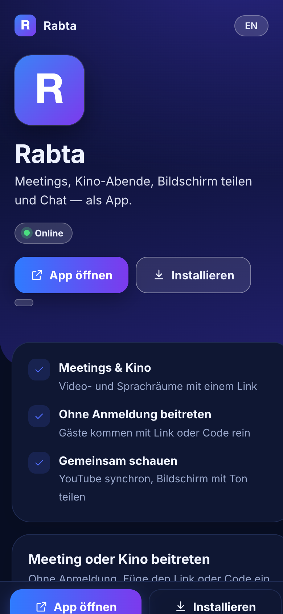
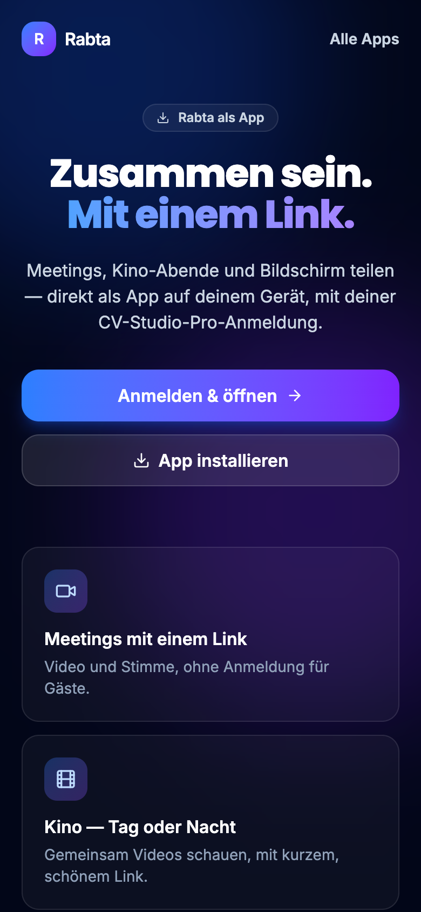
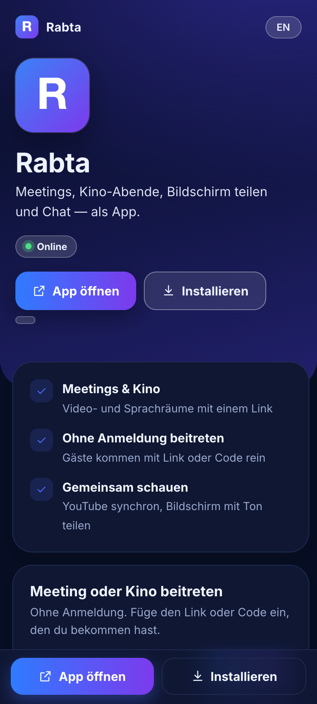
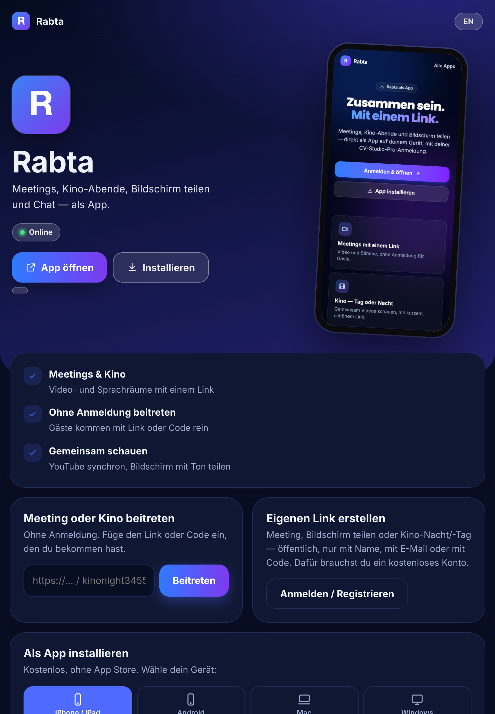
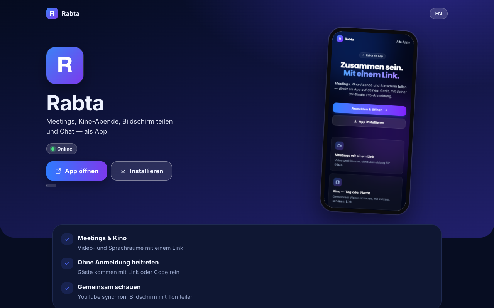

# Rabta

Meetings, cinema nights, screen sharing and chat — as an app.

**Open and install: https://romal10.github.io/rabta/**

 

## What you can do

- **Meetings & cinema** — Video and voice rooms with one link
- **Join without login** — Guests join with a link or code
- **Watch together** — Synced YouTube, screen share with sound
- **Device ID, no login** — A 9-digit ID like the early days — friends connect directly
- **TV mode with QR code** — Full screen on the TV, share a screen by scanning, with sound
- **Celebrate with a wow** — Birthday, wedding, baby: confetti and music for everyone

## How it works

1. Create a free account (or just join someone else's link without one).
2. Start a meeting or a cinema night and choose who may join: anyone with the link, signed-in people only, with name, name + email, or a code.
3. Share the link or a short link (`/k/yourname`). Everyone joins in the browser or the installed app.
4. In the room: camera and microphone, chat, screen share with sound, watch a video together in sync, pins and pen on the shared picture.
5. Open `/rabta-tv` on a TV or big screen: it shows a QR code. Scan it, share your screen with sound, and the TV shows it full screen with a small popup of who is there.
6. Every device gets a 9-digit ID on the web page — share it so friends can reach the room you are hosting, without any login.
7. As host you can mute, hide a person's camera or microphone from others, limit who may speak, and see every link you shared before — with how long it is valid and what was shown.

## Install the app — free, no app store

Open **https://romal10.github.io/rabta/** on the device you want to install on and follow the steps for that device.

| Device | Steps |
|---|---|
| **iPhone / iPad** | 1. Open the page in **Safari**. 2. Tap the **Share** icon. 3. Choose **Add to Home Screen** and confirm. |
| **Android** | 1. Open the page in **Chrome**. 2. Tap **Install** (or menu ⋮ → **Install app**). |
| **Mac** | Chrome or Edge: click **Install**. Safari: **Share → Add to Dock**. |
| **Windows** | Edge or Chrome: click **Install**, or the install icon in the address bar. |

The app then opens in its own window or from your home screen, like any other app. You can also simply use it in the browser.

### What the page looks like on each device

| iPhone | Android | iPad | Mac / Windows |
|---|---|---|---|
|  |  |  |  |

*(Screenshots show this page at phone, tablet and desktop sizes.)*

## Accounts

- Joining a shared link needs no account where the host allows guests.
- Creating things (links, bookings, listings) and using other apps needs a free account — register inside the app.
- Registered users get every feature after signing in; without an account only this one app is available.

## Good to know

- The service runs privately and is reachable while the host computer is online. If the page shows **Offline**, try again later.
- This repository holds only the static launcher page. The application's code and data are not published here.
